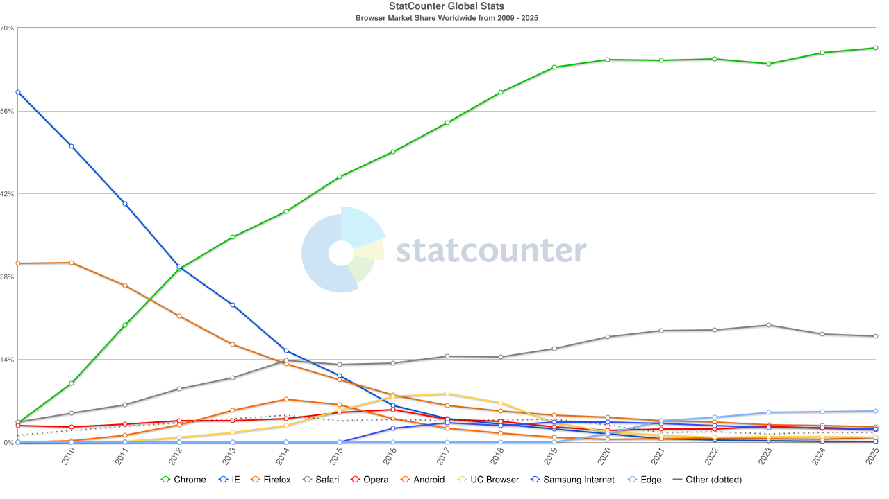

# 🌍
# {}¿Qué es la web?{}

---

- {}¿Son lo mismo **internet** y **la web**?{}
- {}¿Cómo empezó la web?{}
- {}¿Es lo mismo hoy?{}

---

# 🖥️
# ¿Que hace un Navegador?

---

¿Qué navegadores conocen?

---

## Historia

- {}1990: Primer Navegador{}
- {}1993: Primer Navegador Popular{}
- {}1994: Netscape{}
- {}1995: Internet Explorer{}
- {}2004: Firefox{}
- {}2008: Google Chrome{}

---

## Demo: Primer Sitio Web

- {}[1991: info.cern.ch](https://info.cern.ch/){}

---

# 🔗
# ¿Cómo se Transmite?

---

## Protocolo HTTP

{}
Hypertext Transfer Protocol
{}

{}
Protocolo de Transferencia de Hipertexto
{}

---

Secuencia de Navegación

- {}Resolución de la URL{}
- {}Solicitud al Servidor{}
- {}Recepción de la Respuesta{}
- {}Procesamiento y Renderizado{}

---

## Demo, HTTP con CURL

`curl -v http://example.com`

---

# 📜
# ¿Quién Define las Reglas?

---

## Estándares y Especificaciones 

---

- {}Compatibilidad{}
- {}Accesibilidad{}
- {}Seguridad{}
- {}Evolución{}

---

## Monopolio

---

Links

- [Gráfico de Cuota de Mercado de Navegadores](https://gs.statcounter.com/browser-market-share#yearly-2009-2025) 
- [List of Websites before 1995, Wikipedia](https://en.wikipedia.org/wiki/List_of_websites_founded_before_1995)
