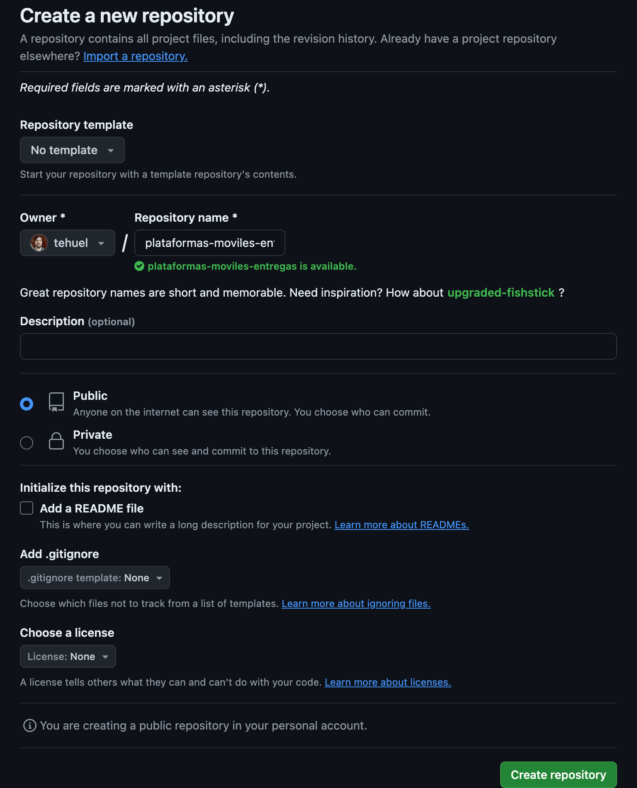
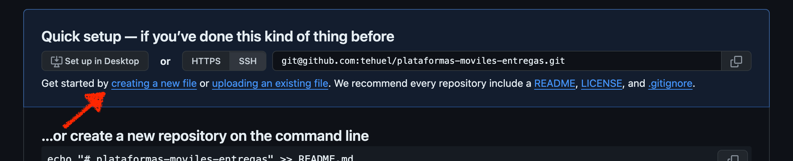
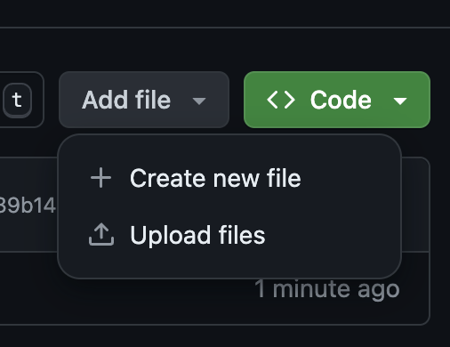
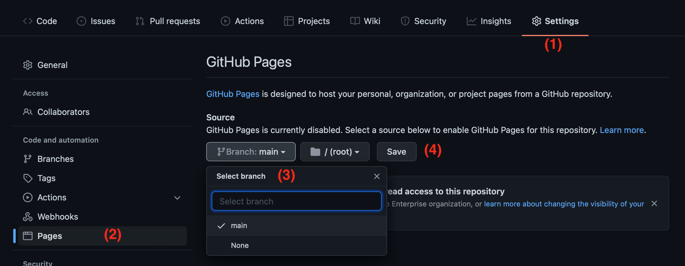
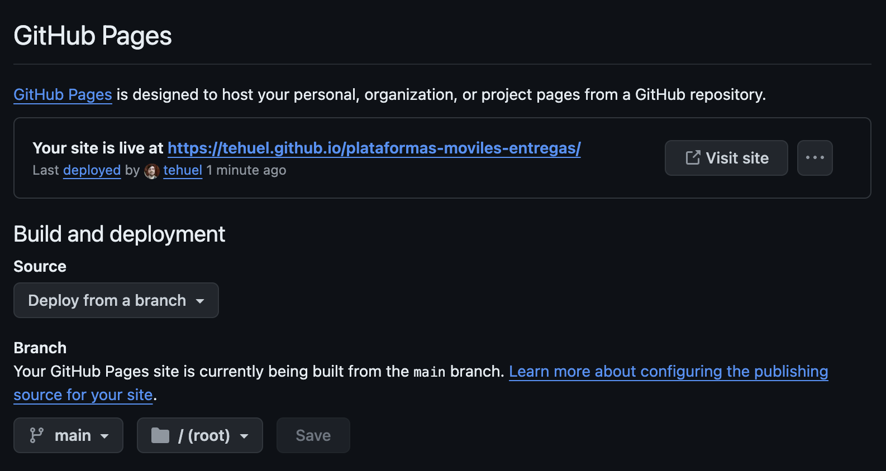
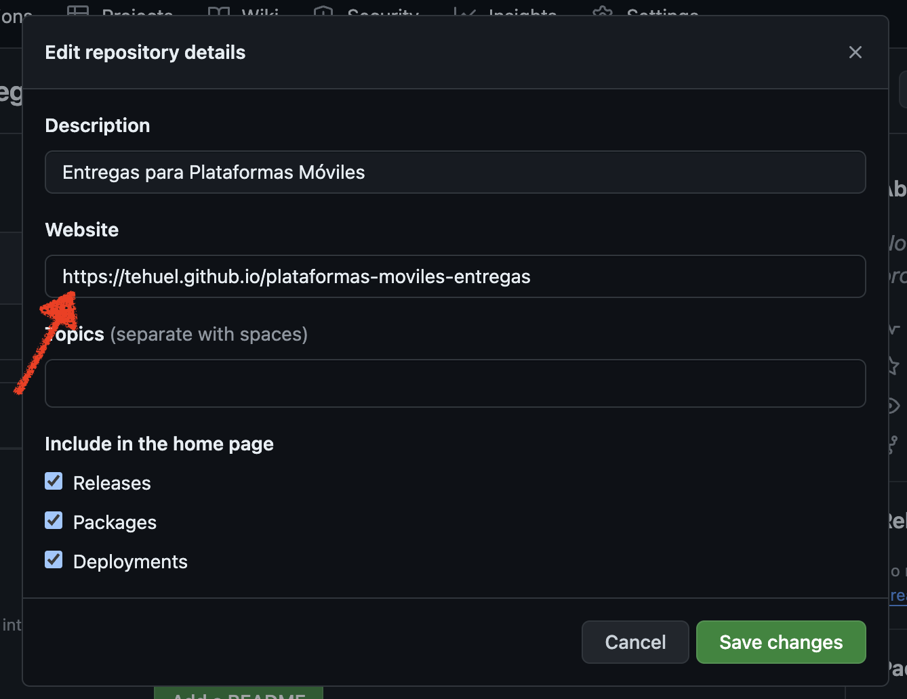

## Objetivo

El objetivo principal de esta actividad es configurar un repositorio en GitHub que sirva como espacio centralizado para las entregas de los trabajos prácticos de la materia Plataformas Móviles.

Además, se busca familiarizar a los estudiantes con el uso de herramientas de colaboración y publicación de contenido web, como lo son GitHub y GitHub Pages.

## Consigna

### 1. Usuario de GitHub

Crear usuario en [GitHub](https://github.com) (si es que todavía no tienen).

### 2. Repositorio

Crear un nuevo repositorio, con el nombre `plataformas-moviles-entregas`.

> **Atención:** el nombre debe ser exacto:
> - todo en minúscula
> - todo en plural
> - separar con guion medio (`-`)
> - sin punto al final

<details>
    <summary>(Screenshot)</summary>



</details>

<details>
    <summary>(Otros Ajustes del nuevo repo)</summary>

- "Description": opcional, puede ser "Repositorio de entregas para la materia Plataformas Móviles".
- "Public/Private": Dejar marcado Public, es necesario en este caso que el repo sea público para que todo funcione.

</details>

### 3. Archivo `index.html` dentro del repo

Dentro del repositorio recién creado, agregar un nuevo archivo.

<details>
    <summary>(Si el repo está vacío)</summary>



</details>

<details>
    <summary>(Si el repo ya tiene archivos)</summary>



</details>

El nombre del archivo debe ser `index.html`, y el contenido puede ser un HTML, por ejemplo:

```html
<!DOCTYPE html>
<html lang="es">
   <head>
      <meta charset="utf-8">
      <meta name="viewport" content="width=device-width, initial-scale=1">
      <title>Hola Mundo!</title>
   </head>
   <body>
     <h1>Trabajos Prácticos</h1>
     <p>Listado de trabajos prácticos para la materia Plataformas Móviles</p>
     <ul>
       <li><a href="tp-html/">TP HTML</a></li>
     </ul>
   </body>
</html>
```


### 4. GitHub Pages

Activar GitHub Pages.

1. Ir a la sección `settings` del repositorio.
2. Ir a la sección `pages` dentro de `settings` del repositorio.
3. Seleccionar la branch `main` y la carpeta `root` del repositorio.
4. Click en `save` para guardar los cambios.
5. Esperar unos minutos a que el servicio se active.



Si todo salió bien, al volver a entrar a la sección pages se debería ver el link en un recuadro.

<details>
    <summary>(Screenshot: link en recuadro)</summary>



</details>

### 5. Link en Detalles

Agregar link a detalles del repositorio.

<details>
    <summary>(Screenshot: link en detalles)</summary>



</details>


## Resultado

Si acceden a la URL `https://{usuario}.github.io/plataformas-moviles-entregas` deberían ver la página publicada.

---

## Posibles Problemas

Llegar a alguno de los siguientes problemas no es algo negativo, por el contrario, indica que el proyecto ya estaría correctamente configurado.

- Error 404: Puede ser que no exista un `index.html` en la raíz del repositorio.
- Página en blanco: Puede ser que el `index.html` en la raíz del repositorio esté vacío.
