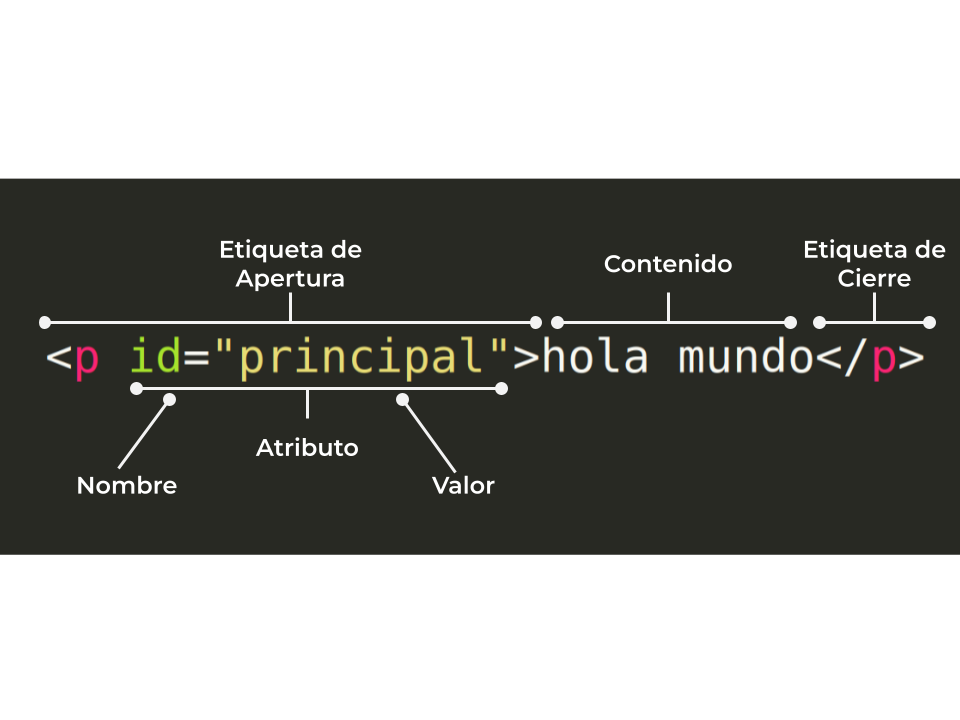
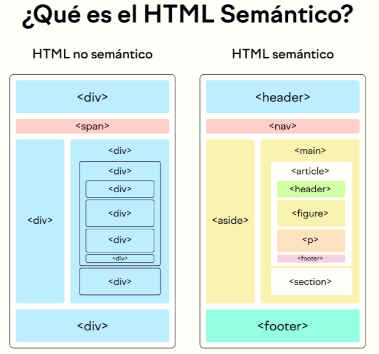

HTML, que significa "Lenguaje de Marcado de Hipertexto" (en inglés *Hypertext Markup Language*), es un estándar fundamental para la creación de páginas web.

HTML proporciona una estructura para la creación de documentos web y se utiliza para describir y definir el contenido de una página web, como texto, imágenes, enlaces, formularios, tablas, entre otros elementos. La esencia de HTML es el "marcado" de elementos mediante etiquetas, que son códigos encerrados entre corchetes angulares (`<>`). Cada etiqueta representa un tipo de contenido o estructura y puede contener atributos que proporcionan información adicional sobre el elemento.

## Estructura del Documento

La estructura básica de un documento HTML se compone de las siguientes etiquetas:

- `<!DOCTYPE html>`: Define la versión de HTML que se está utilizando. En este caso, se usa HTML5.
- `<html>`: Representa la raíz de un documento HTML. El resto de elementos descienden de este elemento.
- `<head>`: Provee información general (metadatos) acerca del documento, incluyendo su título y enlaces a scripts y hojas de estilos. El usuario no puede interactuar con los elementos dentro de esta etiqueta.
- `<body>`: Representa el contenido de un documento HTML. Contiene textos, enlaces, imágenes, etc.

```html
<!DOCTYPE html>
<html lang="es">
<head>
    <title>Título del sitio</title>
    <!--Aquí suele haber enlaces a elementos externos-->
</head>
<body>
    <!--Aquí se incluye el contenido de la página-->
</body>
</html>
```

> En el ejemplo se puede observar que las etiquetas se *cierran* escribiendo `</etiqueta>`

## Etiqueta

Detalle de cada uno de los componentes de una etiqueta HTML.



## Elementos del "body"

Dentro de la etiqueta `<body>` se puede incluir el contenido del documento, mediante diferentes etiquetas. Algunos de ellos son:

- `<h1>`, `<h2>` ... `<h6>`: Representan títulos. Se ordenan del más importante (`h1`) al menos importante (`h6`).
- `<p>`: Etiqueta de párrafo.
- `<div>`: Significa "división" y funciona para seccionar o agrupar contenido.
- `<span>`: Sirve para aplicar estilo al texto o agrupar elementos en línea.
- `<a>`: Permite agregar un vínculo o enlace.
- ``: Permite agregar imágenes.
- `<form>`: Agrega un formulario.
- `<label>`: Se utiliza para asociar un texto descriptivo con un elemento de formulario.
- `<input>`: Crea un espacio para recibir datos del usuario.

[Documentación de Referencia de Elementos HTML](https://developer.mozilla.org/es/docs/Web/HTML/Element)

## Atributos

Los atributos proporcionan información adicional sobre los elementos y les permiten tener características específicas. Estos se definen dentro de la etiqueta de apertura mediante un nombre y su valor.
Algunos ejemplos son:

- **id**: Define un identificador único para el elemento
- **lang**: Define el idioma del contenido
- **src**: Especifica la fuente de la imagen, para una etiqueta ``
- **alt**: Proporciona un texto alternativo para una imagen, para una etiqueta ``
- **href**: Especifica la URL destino de un enlace, para una etiqueta `<a>`

### Sitio web de ejemplo

```html
<!DOCTYPE html>
<html lang="es">
<head>
    <meta charset="utf-8">
    <meta name="viewport" content="width=device-width, initial-scale=1">
    <title>Título del sitio</title>
</head>
<body>
    <h1>Este es un sitio web</h1>
    <p>Lo escribí yo usando HTML</p>
    <div>
      
      <p>Para recordar que <i>HTML</i> <b>no es un lenguaje de programación</b></p>
    </div>
</body>
</html>
```

## Semántica del Código

En HTML, la semántica define el significado y la estructura del contenido. El uso de etiquetas semánticas en lugar de elementos genéricos como `<div>` mejora la organización del código, facilita su comprensión y puede aportar beneficios en accesibilidad y <abbr title="Search Engine Optimization">SEO</abbr>.

Dentro de las etiquetas HTML semánticas podemos incluir:

- `<header>`: Cabecera de un documento o sección.
- `<nav>`: Enlaces de navegación.
- `<article>`: Contenido independiente, como un artículo de blog.
- `<section>`: Sección dentro de un documento.
- `<aside>`: Contenido relacionado o secundario.
- `<footer>`: Pie de página o de sección.
- `<main>`: Contenido principal del documento.
- `<figure>` y `<figcaption>`: Agrupa contenido ilustrativo, como imágenes o gráficos, generalmente acompañado de una descripción.
- `<mark>`: Resalta texto dentro del contenido.
- `<time>`: Representa una fecha u hora, útil para eventos o publicaciones.
- `<address>`: Define información de contacto, como direcciones físicas o electrónicas.
- `<cite>`: Indica la fuente de una cita o referencia.
- `<code>`: Representa fragmentos de código fuente en un documento.
- `<kbd>`: Indica entradas de teclado o comandos del usuario.
- `<samp>`: Representa la salida de un programa o sistema.
- `<abbr>`: Define abreviaciones o acrónimos, permitiendo mostrar su significado completo al pasar el cursor sobre ellos.



## Accesibilidad Básica

La accesibilidad web se refiere a la práctica de diseñar y desarrollar sitios y aplicaciones web de manera que sean accesibles y utilizables por todas las personas, incluidas aquellas con discapacidades o que utilizan tecnologías de asistencia (como lectores de pantalla o navegación únicamente por teclado).

Al escribir HTML, incorporamos criterios básicos de accesibilidad desde la base:

- **Jerarquía de encabezados**: usar un único `<h1>` principal y respetar el orden lógico (`<h2>`, `<h3>`, etc.) sin saltar niveles solo por tamaño visual.
- **Etiquetas semánticas**: usar `<main>`, `<header>`, `<nav>`, `<footer>` y `<button>` en lugar de abusar de `<div>` o `<span>` interactivos.
- **Texto alternativo en imágenes (`alt`)**: describir qué muestra o comunica cada `` relevante (y usar `alt=""` si es puramente decorativa).
- **Formularios etiquetados**: asociar siempre cada control (`<input>`, `<select>`) con su `<label for="...">` correspondiente.
- **Enlaces y botones descriptivos**: evitar textos genéricos como "clic acá" y preferir textos que indiquen qué hace o adónde lleva el enlace.
- **Navegación por teclado y contraste**: asegurarse de que las acciones se puedan recorrer con `Tab` y que el texto sea legible frente al fondo.

Referencias:
- [Accesibilidad en MDN](https://developer.mozilla.org/es/docs/Web/Accessibility)
- [Pautas de Accesibilidad para el Contenido Web (WCAG) - W3C](https://www.w3.org/WAI/standards-guidelines/wcag/es)
