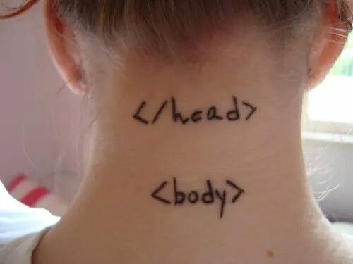
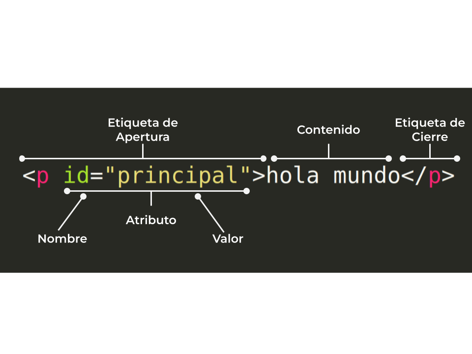
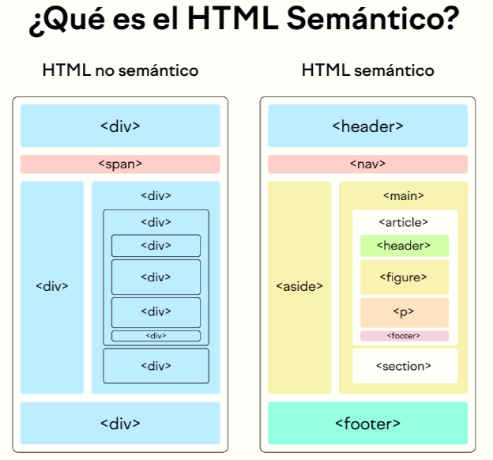

# HTML

{}
Hypertext Markup Language
{}

{}
*Lenguaje de Marcado de Hipertexto*
{}

---



---

Especificación publicada por
# W3C
World Wide Web Consortium

---

Definimos 
# ESTRUCTURA
de un documento

---



---

```html {}
<!DOCTYPE html>
<html>
<head>
  <title>Saludo</title>
</head>
<body>
  <p>Hola Mundo!</p>
</body>
</html>
```

---

# Semántica

{}
Refiere al significado de las palabras.
{}

---

{}
(en html)
{}

# Semántica

{}
Refiere al significado o la estructura del contenido que se está etiquetando.
{}

---



---

# Documentación de Referencia

[developer.mozilla.org/es/docs/Web/HTML/Reference](https://developer.mozilla.org/es/docs/Web/HTML/Reference)

---

# Accesibilidad

---

Links

- Especificación: https://www.w3.org/html/
- Estándares W3C: https://www.w3.org/standards/
- Documentación: https://developer.mozilla.org/es/docs/Web/HTML
- Referencia: https://developer.mozilla.org/es/docs/Web/HTML/Reference
- Accesibilidad: https://www.w3.org/WAI/standards-guidelines/wcag/es