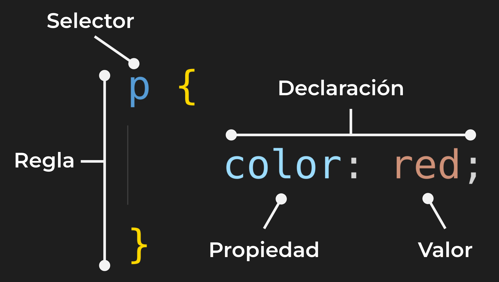
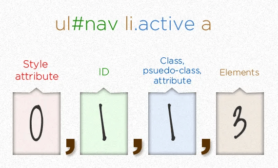

## Puesta en Marcha

Vimos distintas maneras de incluir CSS en un archivo HTML:

- Usando una etiqueta `<link>` dentro del `<head>` de un documento HTML.
- Usando una etiqueta `<style>` dentro del `<head>` o del `<body>` de un documento HTML.
- Agregando un atributo `style=""` a una etiqueta HTML directamente; esto se conoce como estilo *inline* (en línea).

## Lenguaje CSS

Sintaxis de CSS, con los nombres apropiados:



El procesamiento de CSS se hace en orden: en igualdad de condiciones, lo que se escribe último pisa a lo que se escribe primero.

Para un listado completo se puede consultar la [documentación de referencia de selectores](https://developer.mozilla.org/es/docs/Learn/CSS/Building_blocks/Selectors), y también la [documentación de referencia del lenguaje CSS completo](https://developer.mozilla.org/es/docs/Web/CSS/Reference).

## Selectores

### Selectores Básicos

#### Selector de Etiqueta

```css
/* selecciona todos los elementos <p> del documento html */
p {
    /**/
}
```

#### Selector de Clase

```css
/* selecciona todos los elementos del documento html con la clase "elemento" */
.elemento {
    /**/
}
```

#### Selector de ID

```css
/* selecciona todos los elementos con el id "elemento" */
#elemento {
    /**/
}
```

#### Selector Universal

```css
/* selecciona todos los elementos */
* {
    /**/
}
```

### Combinación de Selectores

Podemos unir varios selectores para combinar su funcionamiento. Por ejemplo, para seleccionar todos los párrafos que tengan la clase "resaltado", podemos hacer:

```css
/* selecciona todos los párrafos que tengan la clase "resaltado" */
p.resaltado {
    /**/
}
```

Si unimos con un espacio varios selectores, estamos pidiendo que exista una relación de parentesco entre los elementos. Podemos, por ejemplo, seleccionar todos los párrafos `<p>` que sean descendientes de algún elemento `<div>`.

```css
/* selecciona todos los párrafos que tengan algún ancestro div */
div p {
    /**/
}
```

Para más detalles se puede consultar la documentación de [Combinadores de CSS](https://developer.mozilla.org/es/docs/Learn/CSS/Building_blocks/Selectors/Combinators) en MDN.

### Pseudoclases

Existen selectores que trabajan sobre otros selectores, para funcionar en casos y estados específicos.

Por ejemplo, `:hover` para cuando el puntero está encima, `:visited` para enlaces ya visitados o pseudoclases de posición para el primer y último elemento; hay [muchas más](https://developer.mozilla.org/en-US/docs/Web/CSS/Pseudo-classes).

## Cascada y Especificidad

Se entiende la especificidad como la importancia que se le da a las declaraciones de CSS para determinar qué reglas aplicar cuando un mismo elemento recibe múltiples estilos en conflicto.

Por ejemplo, si se define un estilo general para todas las imágenes de un sitio, pero queremos que la imagen principal se vea diferente, usamos un selector de mayor peso:

- **Selector universal (`*`)**: el menor peso posible.
- **Selectores de tipo (etiquetas)**: afectan a todos los elementos con la misma etiqueta (`p`).
- **Selectores de clase (`.clase`) y pseudoclases**: sobrescriben a los selectores de tipo.
- **Selectores de ID (`#id`)**: sobrescriben a los anteriores; aplican a un identificador único.
- **Estilo inline (`style="..."`)**: sobrescribe a los estilos definidos en archivos `.css`.
- **`!important`**: excepción que pisa cualquier otro selector. Su uso es una **mala práctica** y debe evitarse.

## Ejemplos

Una forma muy clara de ver lo que se puede hacer con CSS es comparar cómo un mismo archivo HTML puede verse de maneras totalmente distintas solo cambiando el CSS:

- [CSS Zen Garden](https://csszengarden.com/): un proyecto que existe desde 2003, donde se usa siempre el mismo HTML y distintos diseñadores crean estilos completamente diferentes usando solo CSS.
- [Style Stage](https://stylestage.dev/): un sitio más moderno, inspirado en CSS Zen Garden, que también usa un HTML fijo y permite enviar hojas de estilo a través de GitHub para cambiar el diseño.

Estos ejemplos muestran cómo el contenido y el diseño pueden ir separados, algo clave en desarrollo web.

---

## Detalles adicionales

<details>
    <summary>Cálculo de especificidad y Batificity</summary>

Cuando se combinan múltiples selectores (como `div p.resaltado`), la especificidad se calcula contando cuántos IDs, clases/atributos/pseudoclases y etiquetas/pseudoelementos componen el selector:



Para practicar el cálculo de forma visual existe el sitio [Batificity](http://batificity.com/).

</details>
