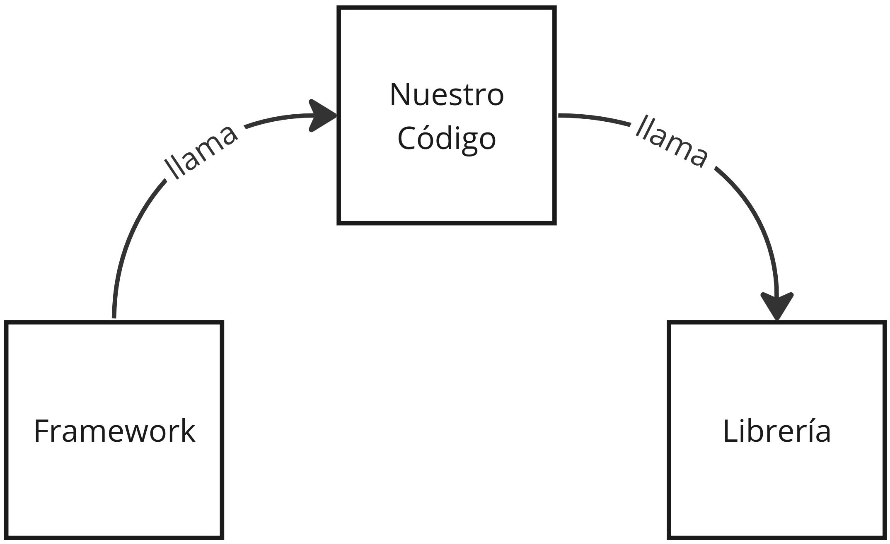
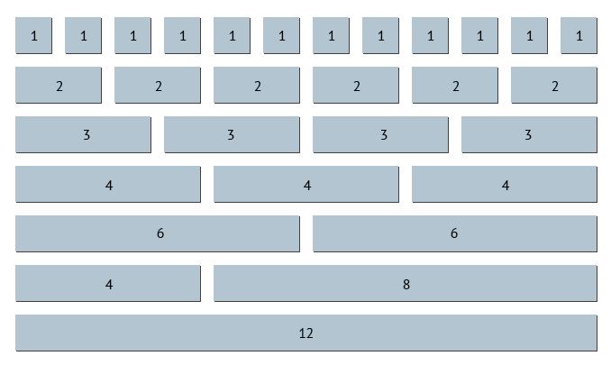
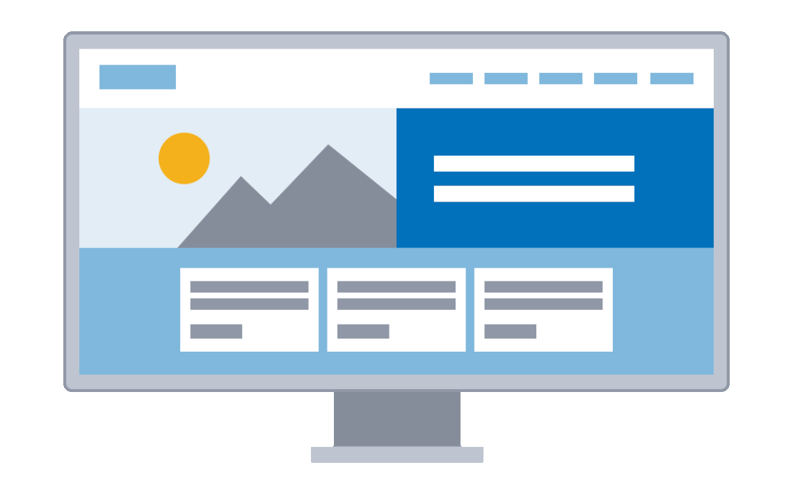
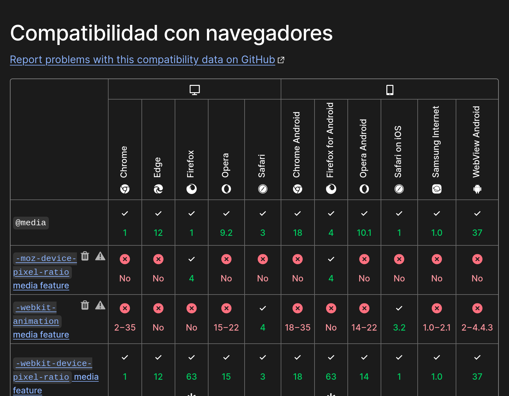

## Diseño Responsivo y Media Queries

La idea de Media Queries es hacer consultas sobre las características del dispositivo (como el ancho de la pantalla) para aplicar estilos CSS de forma condicional.

### Documento de ejemplo

```html
<!DOCTYPE html>
<html lang="es">
<head>
    <meta charset="UTF-8">
    <meta name="viewport" content="width=device-width, initial-scale=1.0">
    <title>Media Queries</title>
    <style>
        @media screen {
            p {
                background-color: yellow;
            }
        }

        @media (min-width: 320px) {
            html {
                background-color: cadetblue;
            }
        }

        @media (min-width: 768px) {
            html {
                background-color: lightsteelblue;
            }
        }

        @media print {
            p {
                color: blue;
            }
        }
    </style>
</head>
<body>
    <p class="parrafo" id="primer-parrafo">Hola Mundo</p>
    <p id="mensaje">Probando estilos según el ancho de pantalla.</p>
</body>
</html>
```

## Frameworks CSS

### Framework vs. Librería

Un **framework** en programación es un conjunto de herramientas, bibliotecas y patrones de diseño que proporcionan una estructura de trabajo para el desarrollo de aplicaciones. Establece reglas y directrices para facilitar la creación de aplicaciones e incluye una arquitectura predefinida, componentes reutilizables y funcionalidades comunes.

Por otro lado, una **librería** es un conjunto de funciones, clases y componentes que se utilizan para abordar tareas específicas. A diferencia de un framework, una librería no impone una estructura o un flujo de trabajo específico, sino que ofrece herramientas concretas.



La principal diferencia está en la **inversión del control**: en un framework el flujo está predefinido y los desarrolladores se ajustan a esa estructura; con una librería, el desarrollador conserva el control y la invoca donde la necesita.

### Ventajas y Desventajas

**Ventajas**

- Ahorran trabajo
- Solucionan problemas comunes
- (Generalmente) siguen buenas prácticas
- Encapsulan funcionalidad compleja, ej. media queries (esto también es una desventaja)
- Permiten compartir conocimiento entre distintos proyectos

**Desventajas**

- Tienen una curva de aprendizaje
- Nos abstraemos del lenguaje de programación
- Tenemos que adaptar nuestro código a lo que el framework quiere
- Al encapsular funcionalidad compleja, se vuelve más difícil depurar problemas específicos

## Bootstrap

[Bootstrap](https://getbootstrap.com/) es un framework de desarrollo front-end ampliamente utilizado que proporciona un conjunto de herramientas y estilos predefinidos para agilizar y facilitar la creación de sitios web responsivos con un enfoque *mobile-first*.

Se basa en HTML, CSS y JavaScript, y ofrece [componentes reutilizables](/temas/3-css/3-bootstrap-componentes/), [grillas flexibles](#sistema-de-grilla-y-breakpoints) y otras funcionalidades interactivas para construir interfaces de manera rápida y consistente.

### Separación entre `Contenedor` y `Contenido`

Al implementar interfaces responsivas con Bootstrap, se aplica una separación clara entre **contenedores** y **contenido**:

- Los *contenedores*, como las clases `container` o `col`, definen el ancho y los límites del diseño en diferentes breakpoints. Establecen cuánto espacio ocupará cada bloque según el tamaño de la pantalla.
- El *contenido* se adapta automáticamente al tamaño disponible dentro de los contenedores, ajustando sus dimensiones para mantener una apariencia coherente en distintos dispositivos.

### Instalación

- **Instalación por CDN**
  - Necesita conexión a internet
  - Depende de la disponibilidad del CDN
- **Instalación local**
  - Funciona sin conexión a internet
  - Es nuestra responsabilidad mantener los archivos actualizados

La instalación consiste en incluir 2 archivos en el HTML: la hoja de estilos CSS y el script JS. En la [documentación oficial](https://getbootstrap.com/docs/5.3/) hay un [ejemplo listo para arrancar](https://getbootstrap.com/docs/5.3/getting-started/introduction/#quick-start):

```html
<!doctype html>
<html lang="es">
  <head>
    <meta charset="utf-8">
    <meta name="viewport" content="width=device-width, initial-scale=1">
    <title>Bootstrap demo</title>
    <link href="https://cdn.jsdelivr.net/npm/bootstrap@5.3.8/dist/css/bootstrap.min.css" rel="stylesheet">
  </head>
  <body>
    <h1>Hello, world!</h1>
    <script src="https://cdn.jsdelivr.net/npm/bootstrap@5.3.8/dist/js/bootstrap.bundle.min.js"></script>
  </body>
</html>
```

Lo importante es la inclusión de los dos archivos:

```html
<link href="bootstrap.min.css" rel="stylesheet">
<script src="bootstrap.bundle.min.js"></script>
```

## Sistema de Grilla y Breakpoints

La grilla de Bootstrap permite estructurar el contenido mediante filas (`row`) y columnas (`col`), dividiendo el espacio horizontal en un sistema de **12 columnas**.



Las columnas se dividen en porciones usando clases como `col-nn`, donde `nn` representa cuántas de las 12 columnas ocupará el bloque (por ejemplo, `col-6` ocupa la mitad de la fila y `col-12` todo el ancho).

Al agregar un infijo de tamaño (`col-sm-nn`, `col-md-nn`, `col-lg-nn`) definimos comportamientos diferentes para cada resolución.

> **Nota:** Existe la clase `col` automática sin número, pero en este curso preferimos ser siempre explícitos con el tamaño para tener un mejor control del diseño en cada pantalla.

### Breakpoints y Responsividad

La responsividad permite que el diseño se adapte a los distintos tamaños de pantalla entre celulares, tablets y computadoras.



Los breakpoints son medidas predefinidas a partir de las cuales cambian las reglas de diseño:

| Breakpoint | Infijo | Dimensión |
|---|---|---|
Extra small | Ninguno | <576px
Small | `sm` | ≥576px
Medium | `md` | ≥768px
Large | `lg` | ≥992px
Extra large | `xl` | ≥1200px
Extra extra large | `xxl` | ≥1400px
{.table}

```goat
XS ---------------------------------------------------->
        SM -------------------------------------------->
                MD ------------------------------------>
                        LG ---------------------------->
                                XL -------------------->
                                        XXL ----------->
 |       |       |       |       |       |
 +-------+-------+-------+-------+-------+--------------
```

Los breakpoints más grandes se van apilando desde el tamaño móvil hacia arriba (*mobile-first*), pisando a los anteriores.

### Ejemplo: Botón Responsivo

Ejemplo para mostrar un botón distinto según el tamaño de la pantalla:

```html
<button type="button" class="btn btn-primary d-none d-sm-block">
    Pantalla Grande
</button>

<button type="button" class="btn btn-secondary d-sm-none">
    BTN
</button>
```

---

## Detalles adicionales

<details>
    <summary>Compatibilidad de navegadores y otras media queries</summary>

Además del ancho de pantalla (`min-width` / `max-width`), existen media queries para detectar el medio de salida (`print` vs. `screen`), la orientación (`orientation: landscape`), preferencias del usuario (`prefers-color-scheme`) o capacidades del puntero (`hover: none`).

Al usar características modernas de CSS conviene revisar la tabla de compatibilidad con navegadores (por ejemplo, en [la documentación de `@media` en MDN](https://developer.mozilla.org/es/docs/Web/CSS/@media#compatibilidad_con_navegadores)):



</details>

<details>
    <summary>Otros frameworks CSS</summary>

Bootstrap es solo una de las opciones disponibles dentro del ecosistema CSS:

- **Tailwind CSS** (basado en utilidades) — [sitio oficial](https://tailwindcss.com/)
- **Frameworks "classless"** (sin agregar clases al HTML) — [listado demo](https://dohliam.github.io/dropin-minimal-css/)
- **Bulma** — [sitio oficial](https://bulma.io/)
- **Pure.css** (muy pequeño y modular) — [sitio oficial](https://purecss.io/)
- **NES.CSS** (estilo retro 8-bit) — [sitio oficial](https://nostalgic-css.github.io/NES.css/)
- **LaTeX.css** (estilo documento académico) — [sitio oficial](https://latex.vercel.app/)

</details>
