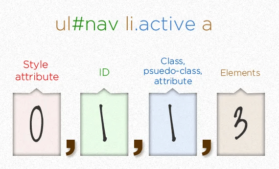

# Especificidad

---

---

|||
|-|-|
| selector universal | `*` |
| elementos (pseudo-elementos)  | `p` |
| clases, atributos (pseudo-clases) | `.resaltado` |
| ids | `#primero` |
| estilos en línea (inline) | `
` |
| modificador | `!important` |

---

Demo

[Batificity](http://batificity.com/)

---

links

- Especificidad: https://developer.mozilla.org/es/docs/Web/CSS/Specificity
- Especificación W3C: https://www.w3.org/TR/selectors/#specificity-rules
- Batificity: http://batificity.com/
