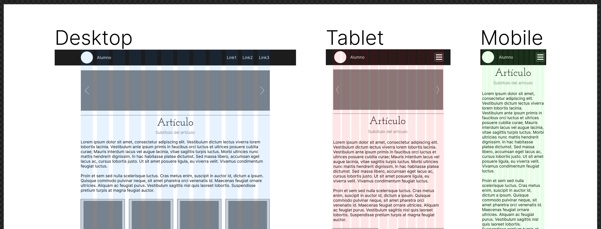

## Objetivo

Usar Bootstrap para reconstruir "la estructura" de un sitio web, partiendo de un diseño.

[ click para ver versión completa del diseño](https://www.figma.com/file/FCPcWiELkdba5KxVf7c3YQ/Grillas---PMoviles?type=design&mode=design)

## Formato de Entrega

- Crear un archivo `tp-bootstrap-layout/index.html` en el repositorio de entregas de la materia, en GitHub.
- Verificar el comportamiento en los distintos breakpoints usando el modo responsive de las herramientas de desarrollo (DevTools) y abriendo el sitio publicado en GitHub Pages desde un celular.

## Consigna

- En ese archivo HTML creado implementar un sitio web que replique la estructura mostrada en los diseños esquemáticos.

## Condiciones

- Usar la última versión de Bootstrap.
- Usar la grilla y las columnas para armar la estructura.
- Incluir los componentes de Bootstrap (como Card, Navbar, Button, etc...) que consideren necesarios.
- Replicar "la estructura" del sitio, sin preocuparse en el aspecto visual o el diseño, sino dando prioridad al comportamiento en diferentes breakpoints.

> **Nota:** El tema o contenido del trabajo es libre. En caso de querer generar texto de relleno, una práctica común es usar [Lorem Ipsum](https://www.lipsum.com/).
