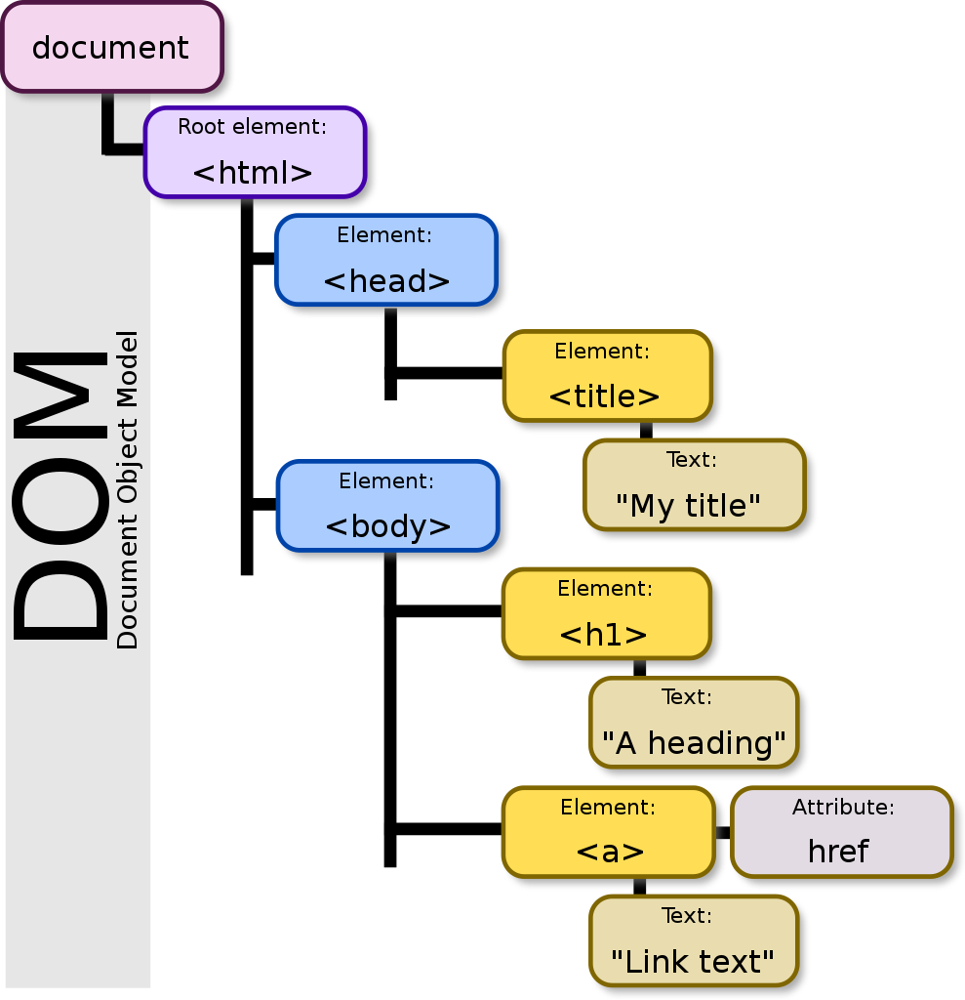

Vimos distintas operaciones que podemos realizar conectando con el *Modelo de Objetos del Documento* (DOM, por sus siglas en inglés). [Referencia en MDN](https://developer.mozilla.org/es/docs/Web/API/Document_object_model/Using_the_Document_Object_Model)

## Interfaces y APIs del navegador

### Interfaz

> Interfaz (del inglés Interface)
> : Conexión o frontera común entre dos aparatos o sistemas independientes.
> : (Informática) Conexión, física o lógica, entre una computadora y el usuario, un dispositivo periférico o un enlace de comunicaciones.
>
> Fuente: [RAE](https://dle.rae.es/interfaz)

### API

> Una API (del inglés, application programming interface, en español, interfaz de programación de aplicaciones) es una pieza de código que permite a diferentes aplicaciones comunicarse entre sí y compartir información y funcionalidades. Una API es un intermediario entre dos sistemas, que permite que una aplicación se comunique con otra y pida datos o acciones específicas.
>
> Fuente: [Wikipedia](https://es.wikipedia.org/wiki/API)

## Organización en Árbol

Podemos pensar la representación del documento HTML como una estructura de árbol, donde encontramos nodos, ramas y hojas todos partiendo desde un nodo raíz.



Fuente: [Wikipedia](https://en.wikipedia.org/wiki/Document_Object_Model)

## Buscar y Modificar Elementos

Para buscar y seleccionar elementos dentro del DOM con [selectores de CSS](/temas/3-css/1-sintaxis-y-selectores/) podemos usar `document.querySelector()` y `document.querySelectorAll()`.

```js
// buscar elementos dentro del documento
document.querySelector(); // nos devuelve el primer elemento
document.querySelectorAll(); // nos devuelve una lista de elementos

let primerParrafo = document.querySelector('p');
let todosLosParrafos = document.querySelectorAll('p');

// podemos usar selectores de CSS con todas las condiciones que necesitemos
let elementoConCondiciones = document.querySelector('div#id > p.clase');
```

Las búsquedas pueden funcionar para encontrar elementos dentro de otros elementos:

```html
<!-- Estructura en HTML -->
<div class="padre">
	<p class="hijo">Elemento Hijo</p>
</div>
```

```js
// podemos buscar un elemento inicial
let elementoPadre = document.querySelector('div.padre');

// y luego buscamos el elemento hijo solo dentro del elemento padre
let elementoHijo = elementoPadre.querySelector('p.hijo');
```

Una vez seleccionado un elemento, podemos leer o modificar sus propiedades y contenido. Para conocer todos los atributos y métodos disponibles, se puede consultar la [documentación de `Element` en MDN](https://developer.mozilla.org/es/docs/Web/API/Element).

Algunas posibilidades frecuentes:
- `innerText`: texto visible del elemento.
- `classList`: agregar, quitar o alternar clases CSS (`add`, `remove`, `toggle`).
- `style`: modificar estilos inline desde JavaScript.
- `disabled`: habilitar o deshabilitar botones y controles de formulario.
- `dataset`: leer o escribir atributos `data-*`.
- `innerHTML`: contenido HTML interno (usar con cuidado).

## Eventos básicos

En JavaScript, los eventos son acciones que ocurren en la página web y a las que podemos responder con código, como un clic en un botón, el envío de un formulario, mover el mouse o presionar una tecla.

Para reaccionar a los eventos se utilizan **_manejadores de eventos_ (event handlers)**, que son funciones que se ejecutan cuando ocurre un evento específico.

Se puede asociar directo desde HTML con el atributo `onclick="miFuncion()"`:

```html
<!-- Evento desde HTML -->
<button onclick="miFuncion()">
	Hacer Algo
</button>

<script>
	// se define el handler de evento desde JS
	function miFuncion() {
		console.log("Hice Algo!");
	}
</script>
```

O también se puede asociar desde JS usando el DOM con `addEventListener()`:

```html
<!-- No se asocia desde HTML -->
<button>
	Hacer Algo
</button>

<script>
	// se define el handler de evento desde JS
	function miFuncion() {
		console.log("Hice Algo!");
	}

	// y también se asocia el evento al elemento desde JS
	document.querySelector('button').addEventListener('click', miFuncion);
</script>
```

### Ejemplo: `Click` en botón

```html
<button id="boton">Hacé click</button>

<script>
  // la función que quiero ejecutar al hacer click
  function clickHandler() {
    alert("Hiciste click en el botón!");
  }

  // asocio función al elemento
  const boton = document.querySelector('#boton');
  boton.addEventListener("click", clickHandler);
</script>
```

---

## Detalles adicionales

<details>
    <summary>Métodos alternativos de búsqueda en el DOM</summary>

Además de `querySelector()` y `querySelectorAll()`, existen métodos específicos más antiguos que también pueden encontrarse en documentación o código existente:

```js
document.getElementById('id');
document.getElementsByClassName('clase');
document.getElementsByTagName('tag');
document.getElementsByName('nombre');
```

</details>
