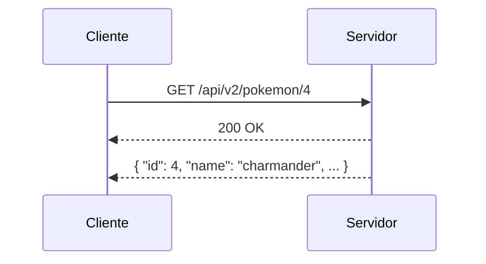

Para usar una API HTTP, nuestra aplicación hace lo mismo que hace el navegador cuando visitamos un sitio web (ver [1.1: Navegadores](/temas/1-web/1-navegadores/)): envía un **pedido HTTP** a un servidor y recibe una **respuesta HTTP**. La diferencia es que, en lugar de una página en HTML, la respuesta trae datos en JSON.

## Request y Response

Cada comunicación con la API tiene dos partes:

- **Pedido** (*request*), lo envía el cliente. Incluye:
	- **Método**: qué queremos hacer. Para pedir datos se usa `GET`.
	- **URL**: a qué recurso queremos acceder.
- **Respuesta** (*response*), la devuelve el servidor. Incluye:
	- **Código de estado**: un número que indica cómo salió el pedido. Por ejemplo `200` (OK), `404` (no encontrado) o `500` (error en el servidor).
	- **Contenido** (*body*): los datos pedidos, generalmente en JSON.



## Endpoint

Una API ofrece distintas URLs, una para cada tipo de recurso o acción. Cada una de esas URLs se llama **endpoint**.

Por ejemplo, la PokéAPI tiene como URL base `https://pokeapi.co/api/v2` y, entre otros, estos endpoints:

| Endpoint | Devuelve |
|---|---|
| `/pokemon/{id o nombre}` | Información de un pokémon |
| `/type/{id o nombre}` | Información de un tipo (fuego, agua, etc.) |
| `/ability/{id o nombre}` | Información de una habilidad |

La URL completa se arma uniendo la URL base con el endpoint: `https://pokeapi.co/api/v2/pokemon/4`.

¿Cómo sabemos qué endpoints existen y qué devuelve cada uno? Leyendo la **documentación** de la API. Por ejemplo, para obtener información de un pokémon, [la documentación](https://pokeapi.co/docs/v2#pokemon) indica que se usa el endpoint `/pokemon/{id o nombre del pokemon}`, y muestra un ejemplo de la respuesta.

## Parámetros

Muchas veces necesitamos indicarle a la API *qué* queremos exactamente. Para eso se agregan **parámetros** en la URL, de dos formas:

**En la ruta**: forman parte del camino de la URL. La documentación los suele indicar entre llaves, como `{id}`.

```shell
https://pokeapi.co/api/v2/pokemon/4
https://pokeapi.co/api/v2/pokemon/charmander
```

**En la *query string***: van al final de la URL, después de un `?`, con el formato `clave=valor`. Si hay más de uno, se separan con `&`.

```shell
https://pokeapi.co/api/v2/pokemon?limit=151
https://www.themealdb.com/api/json/v1/1/filter.php?a=Chinese
```

En el primer ejemplo, el parámetro `limit` le pide a la API una lista de 151 pokémon. En el segundo, el parámetro `a` (*area*) filtra las comidas de origen chino.

En el código, podemos armar la URL con los parámetros usando *template strings*: un texto entre comillas invertidas (`` ` ``) donde `${...}` se reemplaza por el valor de la variable.

```js
const id = 4;
const url = `https://pokeapi.co/api/v2/pokemon/${id}`;
```

## Desde el Browser

Para acceder desde el browser, visitamos el endpoint en la URL `https://pokeapi.co/api/v2/pokemon/4` y obtenemos una respuesta en formato JSON.



### Ver el pedido en las herramientas de desarrollo

Con las herramientas de desarrollo del navegador podemos ver cada pedido y su respuesta:

1. Abrir las herramientas de desarrollo (`F12`) y elegir la pestaña **Red** (*Network*).
2. Recargar la página.
3. Hacer clic en el pedido para ver su **método**, **URL**, **código de estado** y la **respuesta**.

Esta pestaña también muestra los pedidos que hace nuestro código JavaScript, por lo que es muy útil para encontrar errores.

## Desde JavaScript

Para hacer pedidos HTTP desde JavaScript se usa la función [`fetch()`](https://developer.mozilla.org/es/docs/Web/API/Window/fetch).

### Asincronía: esperar la respuesta

Un pedido HTTP **no es instantáneo**: viaja por internet hasta el servidor, el servidor lo procesa y la respuesta vuelve. Puede tardar milisegundos o varios segundos.

Por eso `fetch()` no devuelve los datos de inmediato, sino una **promesa** (*Promise*): un valor que va a estar disponible *más adelante*. Es como pedir en un local de comida: te dan un número de pedido y, mientras lo preparan, podés hacer otras cosas. La página tampoco se "congela" mientras espera.

Para esperar a que la promesa se cumpla y obtener el resultado se usa **`await`**. Y `await` solo se puede usar dentro de funciones marcadas como **`async`**:

```js
async function obtenerPokemon() {
    // 1. envía el pedido y espera la respuesta
    const respuesta = await fetch("https://pokeapi.co/api/v2/pokemon/4");

    // 2. espera a que llegue el contenido y lo convierte de JSON a objeto
    const pokemon = await respuesta.json();

    // 3. ya podemos usar los datos
    console.log(pokemon.name); // "charmander"
}

obtenerPokemon();
```

Hay dos `await` porque son dos esperas distintas: primero llega la respuesta (con el código de estado) y después se termina de recibir y convertir el contenido.

### Manejo de errores

Al depender de la red y de otro sistema, un pedido puede fallar. Hay dos casos principales:

1. **El servidor responde, pero con un error**: por ejemplo, pedimos un pokémon que no existe y la respuesta tiene código `404`. Para detectarlo revisamos `respuesta.ok`, que es `true` solo si el código de estado indica éxito (200-299).
2. **No hay respuesta**: por ejemplo, no hay conexión a internet. En este caso `fetch()` produce un error que podemos atrapar con `try/catch`.

```js
async function obtenerPokemon(id) {
    try {
        const respuesta = await fetch(`https://pokeapi.co/api/v2/pokemon/${id}`);

        // caso 1: el servidor respondió con un error
        if (!respuesta.ok) {
            console.log("Error en la respuesta:", respuesta.status);
            return;
        }

        const pokemon = await respuesta.json();
        console.log(pokemon.name);
    } catch (error) {
        // caso 2: no se pudo completar el pedido
        console.log("No se pudo conectar con la API:", error);
    }
}
```

En una aplicación real, además de mostrar el error en la consola, conviene avisarle a la persona usuaria con un mensaje en la página.

---

## Detalles adicionales

<details>
    <summary>Paginación</summary>

Cuando un endpoint devuelve una lista muy grande (por ejemplo, todos los pokémon), la API no la manda completa: la divide en **páginas** y devuelve una por vez.

En la PokéAPI, el endpoint `/pokemon` (sin id) devuelve una página de 20 pokémon. Con los parámetros `limit` (cuántos) y `offset` (desde cuál) podemos elegir qué página queremos:

```shell
https://pokeapi.co/api/v2/pokemon?limit=20&offset=0    # del 1 al 20
https://pokeapi.co/api/v2/pokemon?limit=20&offset=20   # del 21 al 40
```

La respuesta incluye la cantidad total y las URLs de la página siguiente y la anterior:

```json
{
    "count": 1302,
    "next": "https://pokeapi.co/api/v2/pokemon?offset=20&limit=20",
    "previous": null,
    "results": [
        { "name": "bulbasaur", "url": "https://pokeapi.co/api/v2/pokemon/1/" },
        ...
    ]
}
```

Cada API resuelve la paginación a su manera (`page`, `per_page`, `cursor`, etc.), así que hay que revisar su documentación.

</details>

<details>
    <summary>Autenticación</summary>

Las APIs que usamos en la materia son públicas, pero muchas APIs piden que nos **identifiquemos** en cada pedido. Por ejemplo, para limitar cuántos pedidos hace cada usuario, para cobrar por el uso, o porque dan acceso a datos privados (como nuestra cuenta de Mercado Pago).

La forma más común es una **API key**: un código secreto que la API nos da al registrarnos y que se envía en cada pedido, ya sea como parámetro en la URL o en un *header* del pedido.

Por ejemplo, en las URLs de TheMealDB (`/api/json/v1/1/...`), el `1` es una API key de prueba pública. Para Google Maps, en cambio, hay que registrarse para obtener una.

> **Cuidado**: una API key privada no se debe subir a un repositorio público ni incluir en el código de una página web, porque cualquiera podría verla y usarla.

</details>

<details>
    <summary>Sintaxis alternativa: <code>.then()</code></summary>

Antes de que existiera `async/await`, las promesas se manejaban con el método `.then()`, que recibe una función que se ejecuta cuando la promesa se cumple. Es muy común encontrarla en documentación y ejemplos en internet.

Estos dos códigos hacen lo mismo:

```js
// con async/await
async function obtenerPokemon() {
    const respuesta = await fetch("https://pokeapi.co/api/v2/pokemon/4");
    const pokemon = await respuesta.json();
    console.log(pokemon.name);
}
```

```js
// con .then()
fetch("https://pokeapi.co/api/v2/pokemon/4")
    .then((respuesta) => respuesta.json())
    .then((pokemon) => {
        console.log(pokemon.name);
    });
```

Para los errores, en lugar de `try/catch` se usa `.catch()`:

```js
fetch("https://pokeapi.co/api/v2/pokemon/4")
    .then((respuesta) => respuesta.json())
    .then((pokemon) => console.log(pokemon.name))
    .catch((error) => console.log("Error:", error));
```

</details>

<details>
    <summary>Otros métodos HTTP</summary>

En esta unidad solo pedimos datos con `GET`, que es el método que usa `fetch()` por defecto. Pero las APIs también permiten crear, modificar o borrar datos usando otros métodos:

| Método | Uso |
|---|---|
| `GET` | Obtener datos |
| `POST` | Crear un dato nuevo |
| `PUT` / `PATCH` | Modificar un dato existente |
| `DELETE` | Borrar un dato |

```js
// ejemplo de POST, enviando datos en JSON
await fetch("https://ejemplo.com/api/contactos", {
    method: "POST",
    headers: { "Content-Type": "application/json" },
    body: JSON.stringify({ nombre: "Juan" }),
});
```

</details>

<details>
    <summary>Códigos de estado</summary>

Los códigos de estado se agrupan según su primer dígito:

| Códigos | Significado | Ejemplos |
|---|---|---|
| `2xx` | Éxito | `200` OK, `201` Creado |
| `3xx` | Redirección | `301` Movido permanentemente |
| `4xx` | Error del cliente (el pedido está mal) | `400` Pedido incorrecto, `401` No autenticado, `404` No encontrado |
| `5xx` | Error del servidor | `500` Error interno, `503` Servicio no disponible |

`respuesta.ok` es `true` para los códigos `2xx`.

</details>

<details>
    <summary>Headers</summary>

Además del método, la URL, el código de estado y el contenido, los pedidos y las respuestas llevan **headers** (encabezados): datos extra sobre la comunicación. Por ejemplo, `Content-Type: application/json` indica que el contenido está en formato JSON. Se pueden ver en la pestaña Red de las herramientas de desarrollo.

</details>

<details>
    <summary>Error de CORS</summary>

Por seguridad, el navegador solo permite que una página haga pedidos a una API de otro dominio si esa API lo autoriza. Si no lo autoriza, el pedido falla y en la consola aparece un error que menciona **CORS**.

No es un error de nuestro código: es una configuración de la API. Las APIs públicas pensadas para usarse desde el navegador (como PokéAPI o TheMealDB) lo permiten.

</details>
